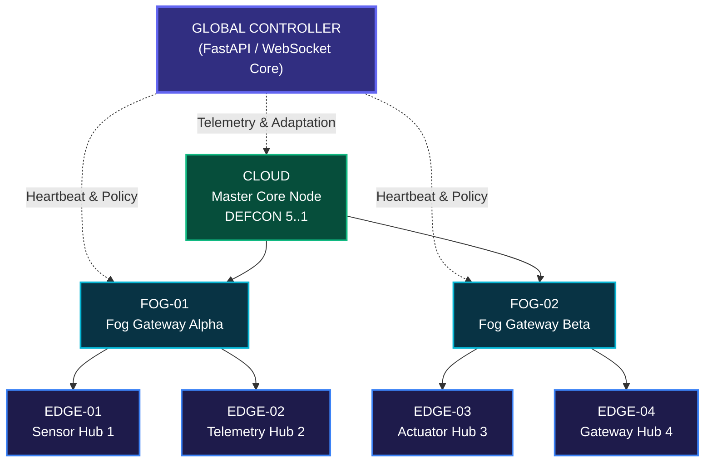
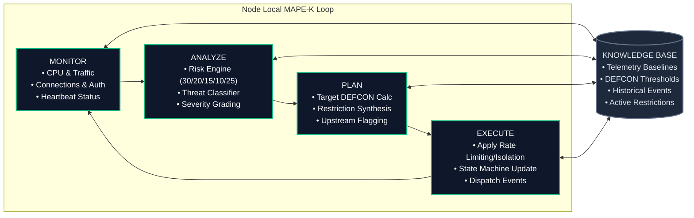
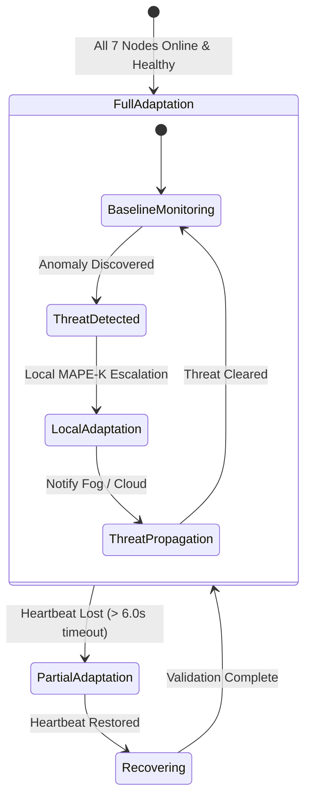
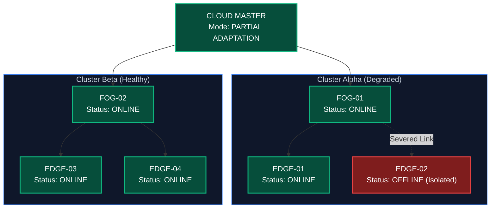
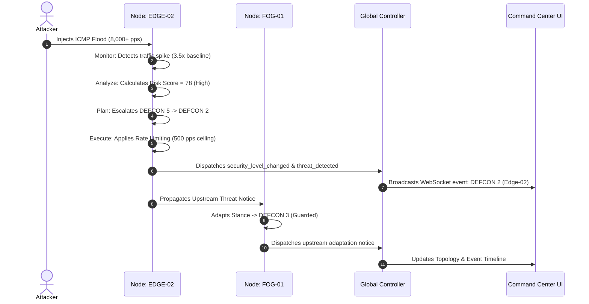
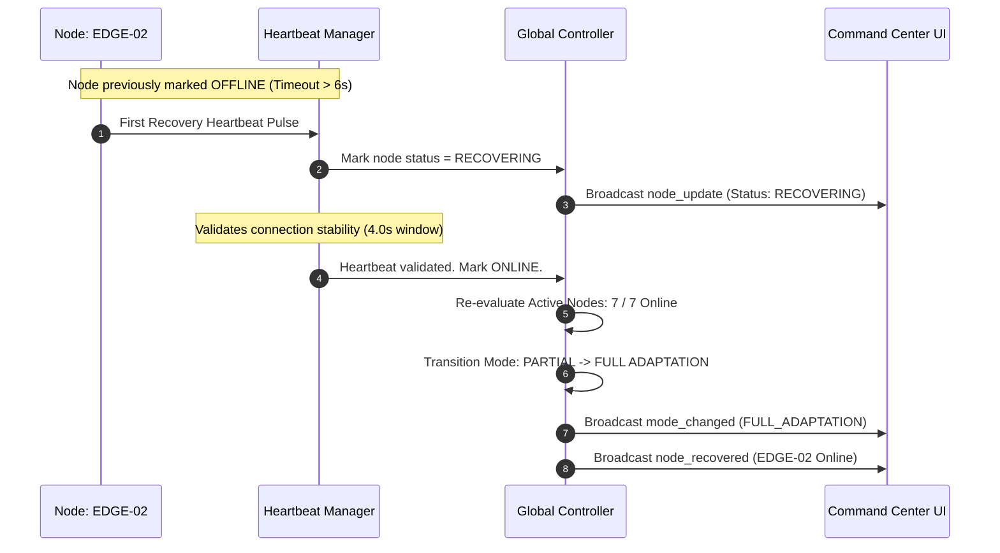

# System Architecture Specification

## 1. Edge/Fog/Cloud Distributed Hierarchy

---

## 2. MAPE-K Autonomous Feedback Loop

---

## 3. Full Adaptation State Machine

---

## 4. Partial Adaptation Architecture (Degraded Partitioning)

---

## 5. Attack Response Flow (e.g. ICMP Flood)

---

## 6. Node Recovery & Reintegration Flow

